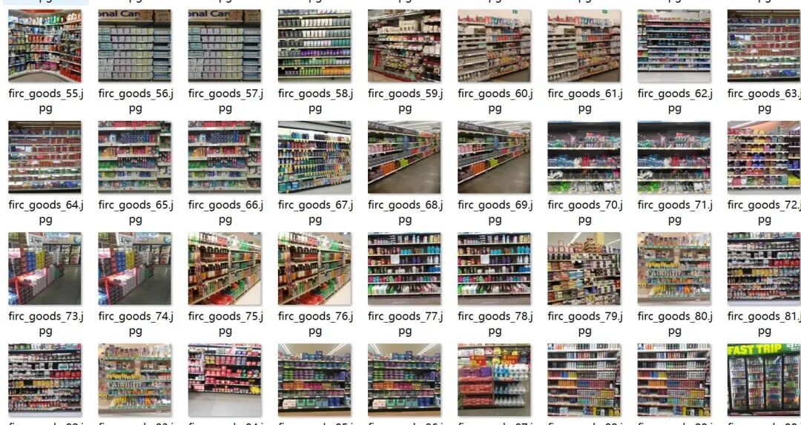
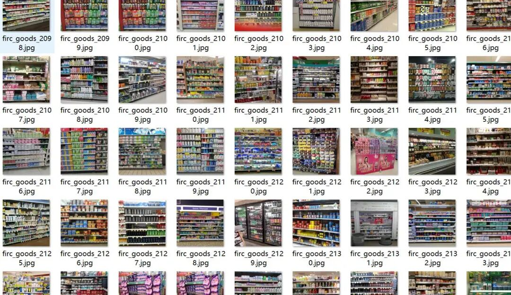
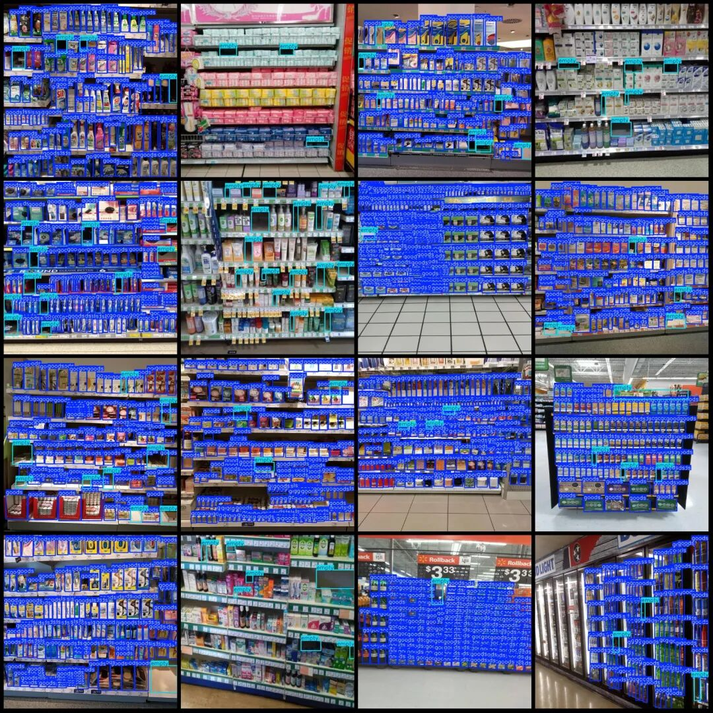
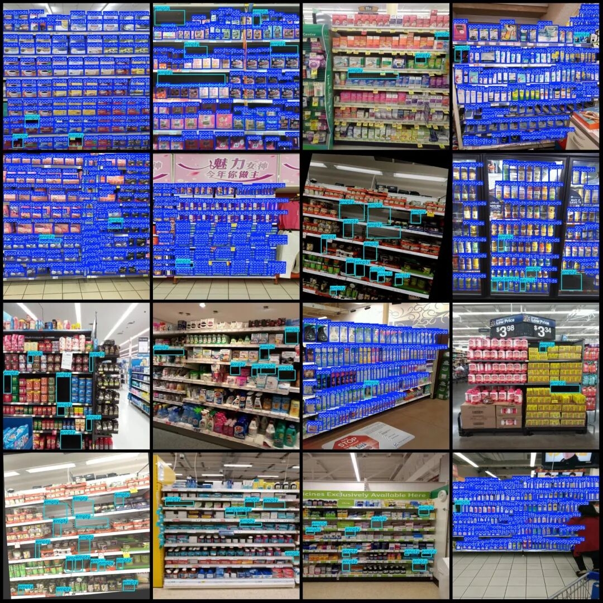

# Supermarket Shelf Item Gap and Sale Detection Data Set VOC+YOLO Format with 2709 Images in 2 Categories

It is normal for the dataset to not include annotations for products. The purpose of annotation is to prevent misdetection. Without annotations, the model will be trained as a background, while those marked can be filtered out during detection.

Dataset format: Pascal VOC format + YOLO format (txt file without split path, only containing jpg images and corresponding VOC format xml files and yolo format txt files)

Number of images (number of jpg files): 2709

Number of annotations (number of xml files): 2709

Number of annotations (number of txt files): 2709

Labeling category count: 2

Label category names (Note that the order of yolo format categories does not correspond to this, but is based on the labels folder's classes.txt): ["empty", "goods"]

Number of boxes labeled in each category:

Empty box count = 15721

Goods Frame Count = 228488

Total frames: 244,209

Number of images per category:

Empty possession count = 2642

Goods occupancy count = 1552

Image resolution: 640x640

Using labelImg:

Annotation rules: Draw a rectangle around the category.

Important Notice: The dataset does not have separate training, validation, and test sets; you need to partition them yourself.

Special : This dataset does not guarantee the accuracy of the trained models or weight files.

Image Preview:

Annotation example:

## Payment

Here is a pay link on Stripe ( https://buy.stripe.com/3cs8yP7sY87d0vu9AB ). Please contact me lonlonago@foxmail.com after funding $89, and I will send you a complete data files , thank you!

